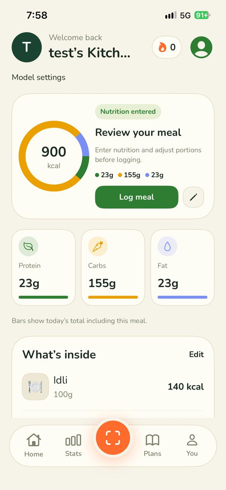
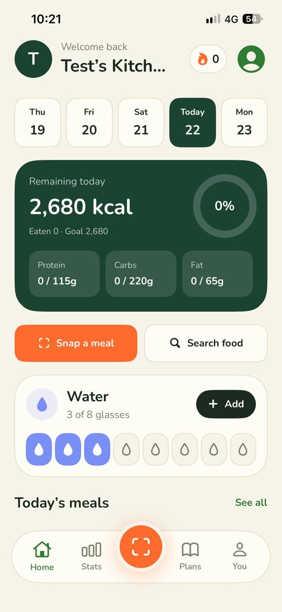
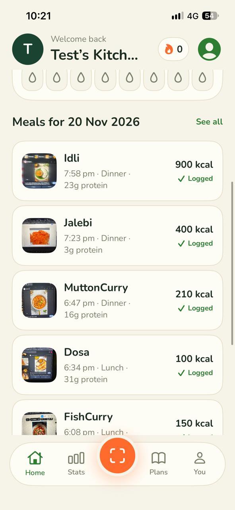
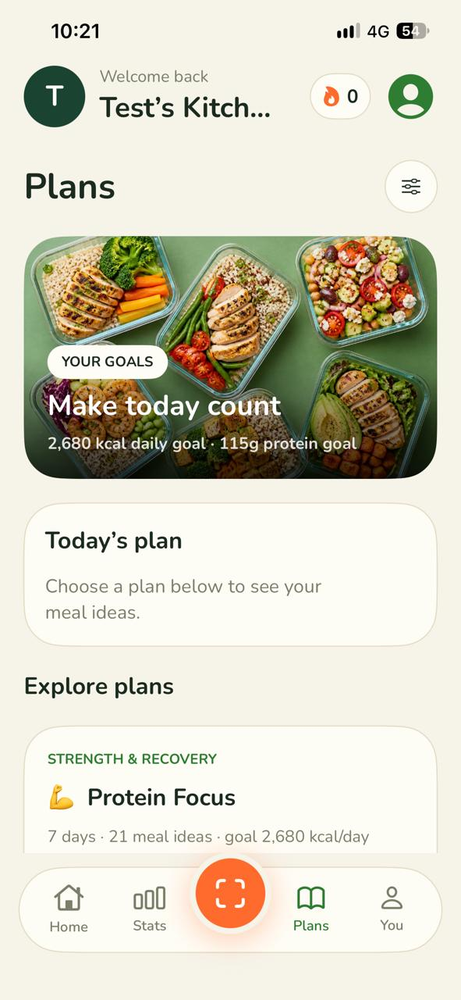
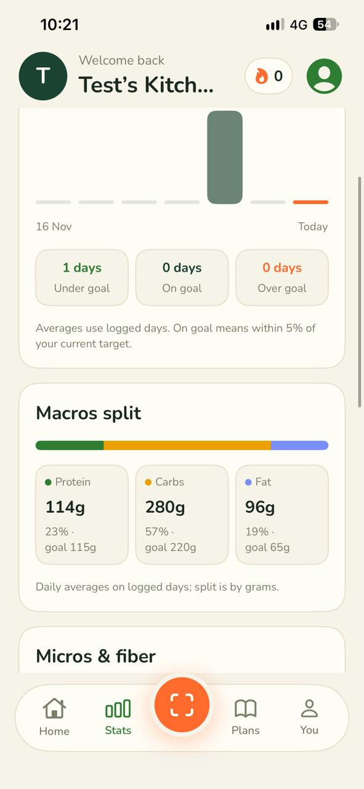
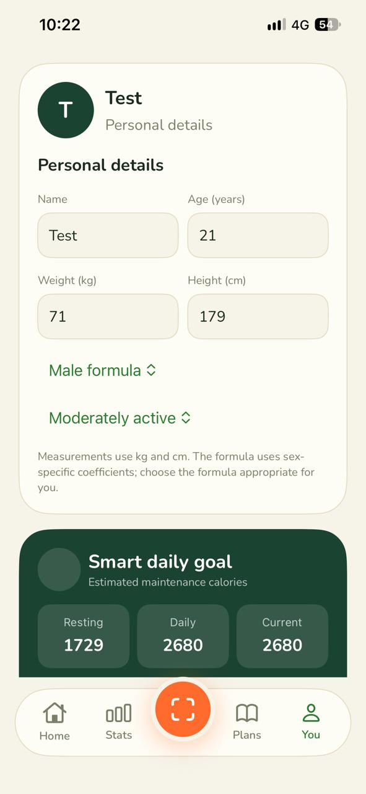
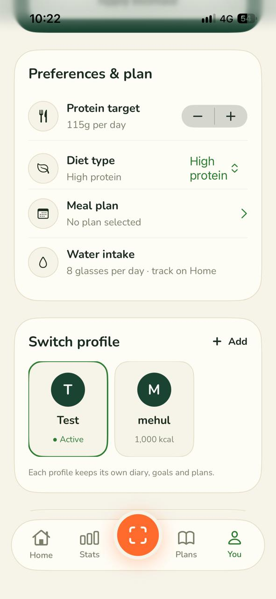

# SnapBite

SnapBite is an iOS app that helps you track what you eat by snapping a photo of your meal. It uses on-device/Roboflow-based food detection to identify dishes, estimates calories and macros, and logs them into a personal food diary with daily goals, streaks, and meal plans.

> Repository: [Epicguest97/SnapBite](https://github.com/Epicguest97/SnapBite)

## Screenshots

<p align="center">
  
  
  
  
  
  
  
</p>

## Features

- **Scan a meal** — Capture a photo with the in-app camera. Live object detection draws bounding boxes over detected foods; take a photo to review.
- **AI nutrition estimate** — Detected foods are mapped to per-100 g nutrition estimates (calories, protein, carbs, fat, fiber, vitamins, iron, sodium, sugar) and scaled to the portion size.
- **Review & edit** — Adjust quantities and nutrition values before logging. Add foods manually if needed.
- **Food diary** — Log meals by type (Breakfast, Lunch, Dinner, Snack) with photos. Edit or delete entries within 24 hours.
- **Daily goals** — Track calories, protein, carbs, and fat against customizable targets. Water intake tracker (8 glasses).
- **Profiles** — Multiple profiles, each with its own diary, goals, and plans.
- **Smart daily goal** — Mifflin–St Jeor BMR × activity level estimate, applied to your calorie target.
- **Plans** — 7-day meal plan templates (Protein Focus, Veggie Balance, Heartwise) with daily meal ideas.
- **Stats & streaks** — Weekly calorie chart, average calories/protein, goal days, and streak tracking.
- **Insights** — Protein goal days and late-night snack counts for the week.
- **Sharing** — Share a photo, meal summary, or both via the system share sheet.

## Tech Stack

- **Language/UI:** Swift, SwiftUI
- **Platform:** iOS 15.4+
- **Detection:** [Roboflow](https://roboflow.com) iOS SDK (`Roboflow` pod) for live food detection
- **Camera:** AVFoundation (`AVCaptureSession`, `AVCaptureVideoDataOutput`)
- **Persistence:** `UserDefaults` + JSON files in Application Support (profiles); `UserDefaults` for meals/goals/water
- **Font:** Nunito (bundled)
- **Theme:** Custom `AppTheme` color palette

## Requirements

- Xcode 15+ (SwiftUI, iOS 15.4 deployment target)
- CocoaPods
- A Roboflow account with a trained food-detection model (model ID + version + API key) configured in **Model settings** inside the app
- An iOS device or simulator with camera support (camera features require a device)

## Getting Started

1. Clone the repository:
   ```sh
   git clone https://github.com/Epicguest97/SnapBite.git
   cd SnapBite
   ```
2. Install pods:
   ```sh
   pod install
   ```
3. Open the workspace (not the project):
   ```sh
   open biteAi.xcworkspace
   ```
4. Build and run on a device/simulator from Xcode.
5. In the app, open **Model settings** and enter your Roboflow API key, model ID, and version to enable live detection.

## Project Structure

```
SnapBite/
├── Podfile / Podfile.lock          # CocoaPods (Roboflow)
├── biteAi.xcodeproj / .xcworkspace
├── biteAi/                         # App source
│   ├── biteAiApp.swift             # @main entry point
│   ├── ContentView.swift           # Main tabs + home/scan views
│   ├── Models.swift                # Data models, stores, theme
│   ├── LiveCameraView.swift        # AVFoundation + Roboflow live detection
│   ├── ImagePicker.swift           # Photo picker wrapper
│   ├── FoodNutrition.swift         # Per-food nutrition estimates + migration
│   ├── LogView.swift               # Diary/stats view
│   ├── PlansView.swift             # 7-day meal plans
│   ├── ProfileView.swift           # Profile, goals, insights
│   ├── PersonalGoalCard.swift      # Personal details & smart goal
│   ├── Info.plist
│   ├── Assets.xcassets
│   └── Nunito.ttf
├── model-downloads/                # Downloaded CoreML model bundle
└── Pods/                           # (generated)
```

## Data & Privacy

- Meals, goals, profiles, and personal details are stored **locally** on the device (UserDefaults + Application Support JSON). No backend server is used by the app.
- Camera frames are processed for on-device detection via the Roboflow SDK using the credentials you provide.
- Food nutrition values are illustrative per-100 g estimates; recipes and portions vary.

## Notes

- Editing a logged meal is available for 24 hours after logging.
- Meal plan ideas are examples, not personalized prescriptions; your calorie target is unchanged when selecting a plan.
- Streaks and "goal days" are based on your current calorie target.

## License

No license file is included yet. All rights reserved by the author unless specified otherwise.
